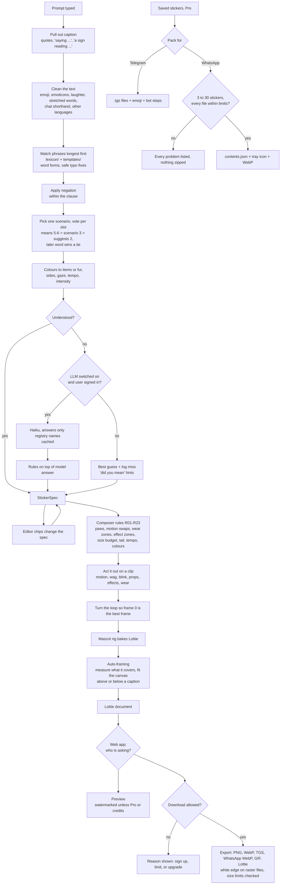

# How a sticker gets made

Every decision between a typed sentence and a downloaded file, in the order it happens, with the file that owns it
and the knob that changes it. Rules make every decision. A model is consulted only when the rules don't understand
a prompt, and only when that is switched on. `python -m studio.cli --rules` prints every numbered rule
(P01–P33 reading, R01–R23 composing, L01–L11 what the library guarantees).

## Contents

1. [The pipeline at a glance](#the-pipeline-at-a-glance)
2. [Reading the prompt](#1-reading-the-prompt)
3. [Turning matches into a spec](#2-turning-matches-into-a-spec)
4. [When the rules don't understand](#3-when-the-rules-dont-understand)
5. [Composer rules](#4-composer-rules)
6. [Animation, still frame, caption and framing](#5-animation-still-frame-caption-and-framing)
7. [Web app gates](#6-web-app-gates)
8. [Export, packs and messenger limits](#7-export-packs-and-messenger-limits)
9. [A worked trace](#8-a-worked-trace)
10. [Where to tweak](#9-where-to-tweak)

## The pipeline at a glance

| Stage | File |
| --- | --- |
| Cleaning the text | `studio/parse/text.py`, `lexicon/core.yaml`, `lexicon/translations.yaml` |
| Reading the prompt, voting | `studio/parse/parser.py`, `morph.py`, `typo.py`, `lexicon/*.yaml`, `templates/*.yaml` |
| Fallback | `studio/parse/fallback.py` |
| The spec and its allowed names | `studio/spec.py`, `studio/registry.py` |
| Composer rules | `studio/rules.py`, `studio/colour.py` |
| Motions, props, effects, things worn, faces, mascots | `studio/library/*.py` |
| Clip, still frame, framing | `studio/compose.py`, `studio/framing.py` |
| Mascots | `mascot/characters/*.py` (14) |
| Caption | `studio/caption.py` |
| Files | `studio/export.py` |
| Packs | `studio/packs.py` |
| Web app gates | `app/plans.py`, `app/render.py`, `app/main.py` |
| Editor chips | `app/vocab.py` (read from the registry) |
| Beta: invites, waitlist, reports, counts | `app/main.py`, `app/admin.py` |

## 1. Reading the prompt

The prompt is read by rules only (`studio/parse/parser.py`). No model is called at this stage.

1. **Pull out the caption first (P01, P02).** Quoted text (`"Deal!"`, `'monday again'`) or whatever follows `saying`,
   `says`, `that says`, `with text`, `captioned`, `caption:` or `text:` becomes the caption, word for word; so does what
   follows "a sign / board / banner / card reading". "reading a book" stays reading. A lead-in such as "with the
   words" before quoted text is dropped. "no caption" or "without text" turns the suggested caption off.
2. **Clean the text (P03–P08, `text.py`).** Colour codes become colours. Emoji and emoticons become the words they
   stand for (😴 sleepy, :D laughing, 🥺👉👈 shy). Laughter in any spelling (hahaha, lolol, jajaja, kkkk, 555, xD) is
   one word. Stretched words shrink to a word the lexicon knows (heyyyy → hey). Chat shorthand and contractions are
   spelt out (omw, brb, ty, ily, idk, hbd; can't → can not). A word the lexicon lists exactly is never changed.
   Lowercase, accents dropped; `,` `.` `;` `!` `?` become a clause break.
3. **Other languages (P09).** Whole phrases from `translations.yaml` are read as English (feliz cumpleaños, eid mubarak,
   arigatou gozaimasu, শুভ জন্মদিন …); a one-word phrase is matched as typed first.
4. **Match phrases, longest first (P10–P13).** Every phrase of the lexicon and the templates is tried from the longest
   down. A matched phrase claims its words ("ice cream" before "ice"). A word nothing matched is tried as a word form
   of a listed word (clapping → clap, happier → happy, `morph.py`), then as a typo (`typo.py`: a real English word is
   never "fixed", the fix must be one or two edits away, and two equally close candidates mean no guess). Little words
   and fillers ('ngl', 'pov', 'all night') carry no meaning.
   - A phrase belongs to one lexicon entry only, and may also belong to a template; both fire.
   - Some words mean something only as the whole prompt (P14, `alone:` in `core.yaml`): "nice" alone is a thumbs up,
     "nice fox" is a fox. "No!" alone is a head shake (P15).
5. **Negation (P16–P18).** `not`, `no`, `never`, `without` … negate the next thing said in the same clause; in a list
   after a negator every item is negated. A negated feeling becomes its partner ("not happy" is sad, "not scared" is
   determined). A negated prop, effect or worn item is kept out, even when a scenario would bring it ("birthday
   without the hat").

What the parser can match (`python -m studio.cli --list templates` and friends):

| Source | Holds | Weight |
| --- | --- | --- |
| `templates/everyday.yaml`, `occasions.yaml` | 220 scenarios, each a spec plus a suggested caption | 3 |
| `lexicon/moods.yaml` | 56 feelings: what they MEAN (a face) and SUGGEST (motion, effects, stance) | means 5, suggests 1.5 |
| `lexicon/actions.yaml` | 98 doing words, each meaning a motion | means 5, suggests 2.2 |
| `lexicon/things.yaml` | 76 props, 43 effects, 56 worn items | means 5, suggests 2 |
| `lexicon/poses.yaml`, `mascots.yaml` | 31 poses and stances; 14 mascots with 33 named variants | 6 |
| `lexicon/colours.yaml` | 45 colours and 6 shade words | — |
| `lexicon/core.yaml` | stopwords, fillers, negators, intensity, tempo, sides, gaze, words that only count alone | — |

## 2. Turning matches into a spec

Every decision lands in one `StickerSpec` (`studio/spec.py`). The parser fills it, the editor chips change it, and
everything after this point reads only the spec.

1. **Pick at most one scenario (P29).** Each matched template scores the words its phrases covered; the highest wins,
   then the one said first. Its spec goes in at weight 3, and its caption is suggested when the prompt has none (P30).
2. **Vote on single-value slots (P19–P21).** `face`, `motion`, `stance`, `tail`, `arm_L`, `arm_R` and `base` collect
   votes. What a word means (5, poses and mascots 6) beats a scenario (3), which beats what a word only suggests (2).
   On a tie the later word wins ("tired but dancing" dances). Vague words count less (please, maybe; yes and no 0.9).
   A motion suggests its own face when nothing else sets one (P32: eating looks happy, sobbing cries).
3. **Collect lists.** `props`, `effects` and `accessories` in order of mention, minus anything negated.
4. **Colours (P22–P25).** A colour paints the item right after it ("a red scarf", "red and white scarf"), or the item
   before it with 'in' ("a scarf in red"); otherwise the fur ("purple kitty with coffee" is a purple cat). A colour
   before 'eyes' colours the eyes. Shade words change it (light blue, dark red, pastel pink, neon green). Some mascot
   words bring a fur colour (polar bear, golden retriever) unless a colour is named.
5. **Sides, gaze, tempo (P26, P27).** 'left paw' puts the nearest held thing in that paw; 'looking up', 'side eye'
   set the gaze; 'fast', 'slowly' the tempo.
6. **Intensity (P28).** Starts at 1.0, ×1.35 per strong word, ×0.65 per soft word, more for `!!!` and CAPITALS.
   Clamped to 0.5–1.6. Motions scale their amplitude by it.
7. **Captions as hints (P31).** When only the caption says anything ("a fox saying 'good morning'"), its words hint at
   the scenario and the mood, lightly.
8. **Confidence (P33).** Understood when something in the prompt means a sticker part and few words are left unknown.
   Unknown words get a 'did you mean' suggestion in the editor.

Defaults when nothing sets a slot:

| Slot | Default |
| --- | --- |
| base | `biscuit` (fox) |
| face | the motion's own face, else `smiley` |
| motion | `idle` |
| stance | the motion's, else `stand` |
| tail, arms | chosen by the composer (section 4) |
| intensity, tempo | 1.0 |
| length | 2 seconds at 60 fps (120 frames); 1 to 3 seconds allowed |

## 3. When the rules don't understand

The fallback (`studio/parse/fallback.py`) runs only when step 2 says "not understood". Word forms and typos were
already tried inside the parser.

1. **Small model (optional).** Only when the LLM switch is on (`--llm` on the command line; `STUDIO_LLM=1` in the web
   app, signed-in users only, `STUDIO_LLM_DAILY` calls a day each). Claude Haiku (`STUDIO_LLM_MODEL`, default
   `claude-haiku-5-5`) must answer a JSON schema whose fields are lists of the registry's own names: face, motion,
   stance, props, effects, accessories, plus `unknown_concepts` for what it can't show. It can't invent a pose or a prop.
   - The rules still win. The model's answer only fills what the rules left empty, and its props, effects and worn
     items go after the rules' own.
   - Answers are cached by normalised prompt in `cache/llm.json`; the same wording never costs twice.
   - No credentials, an auth error, a network error, a refusal or a cut-off answer all mean "no answer".
2. **Log the miss.** Every prompt that reached this step is appended to `cache/misses.jsonl` (capped) with its unknown
   words and whether the model was used. Adding those words to the lexicon is how the rules learn.
3. **Best guess.** Whatever the rules did understand is kept; the rest stays at its default, and the editor says it
   wasn't sure and suggests words.

## 4. Composer rules

`resolve()` in `studio/rules.py` runs these in order. Every change it makes is written to `notes`, which the editor
shows under the sticker. The facts each rule reads (which paws a motion wants, where a worn item sits, what a prop is
for) come from the registry, so a new item obeys the rules without touching them.

| Rule | What it does |
| --- | --- |
| R01 | At most 2 props, 3 effects and 3 worn items, the first ones listed |
| R02 | A motion that acts with something brings it when nothing held can be used: typing brings a laptop, singing a microphone, eating the mascot's favourite snack (a bone for the dog, bamboo for the panda) |
| R03 | A sitting-only motion (dozing, kicking its feet) sits the mascot down |
| R04 | Held props claim paws first: the paw the spec names, else the prop's own paw, else the other; two-paw props need both |
| R05 | A motion done with a thing that has its own use becomes that use: waving a flag, cheering with a glass raises a toast, dancing with a microphone sings, with a guitar strums |
| R06 | A prop that needs a stance gets it (feet apart either side of a gift box) |
| R07 | A motion that needs legs is swapped for one that works sitting |
| R08 | A held prop the motion acts with goes with the motion: a snack to the mouth, a mug is sipped, a phone to the ear |
| R09 | The motion gets the paws that are left; with too few it becomes its fewer-paws version, else a bounce |
| R10 | Unclaimed paws take the spec's pose, else rest on the knees cross-legged, else hang |
| R11 | A costume of what the mascot already has is left out (bunny ears on the bunny) |
| R12 | One worn item per place on the body (hat, eyes, ears, neck, back …) |
| R13 | Something over the mouth comes off for eating, sipping, singing, a kiss; a sleep mask comes off for reading, typing, photos |
| R14 | Something over the eyes hides special eyes (hearts, stars); the note says what doesn't show |
| R15 | An effect the motion already draws is not drawn twice (sobbing has its own waterfall tears) |
| R16 | One effect over the head and one behind the mascot |
| R17 | Telegram's 64 KB: when props and effects add up to too much, the costliest effect goes |
| R18 | The tail follows the stance (sitting tail poses when sitting) |
| R19 | A calm motion keeps a calm tempo (dozing is never played faster than 1.2×) |
| R20 | A fur colour repaints every shade of it (arms, legs, tail, stripes) and keeps eyes and paws readable |
| R21 | A worn or held thing takes the colour the spec gives it, else the first colour it likes that stands out from the fur |
| R22 | With a gift box and a loop of at least 100 frames the gift is the act: paws on the lid, it pops, a cheer, the lid drops back |
| R23 | A sign carries the caption when it is short enough to read there |

## 5. Animation, still frame, caption and framing

`build_clip()` and `compose()` in `studio/compose.py`, then the rig bakes it (`mascot/character.py`).

1. **Loop length.** `seconds × 60` frames (default 120). Every periodic movement uses a period that fits a whole number
   of times into the loop (`m.per()`), every one-shot finishes before the loop ends, and every key ends on its start
   value, so the last frame equals the first at any length or tempo (L01–L03).
2. **Motion.** One of 99 functions in `studio/library/motions_*.py`, each given the paws, stance, mascot and the props
   it acts with. Each returns its best still frame (jump apex, wave at the top of its swing, the bite …).
3. **Tail wag and blink.** The motion's wag strength, halved when sitting, × intensity. One blink at 80 % of the loop
   unless the face or the motion keeps the eyes closed or special.
4. **Props, effects, things worn.** Added as layers. Everything is placed from the mascot's own data (crown, top,
   collar, eyes, ears, nose, mouth, paw anchors), so it fits all 14 mascots and follows every head turn (L06, L08).
   Things a motion acts with stay upright (L07).
5. **Frame 0 is the best frame.** The loop is turned so that frame 0 shows the motion's key pose with every effect at
   its fullest. The PNG still, Telegram's first frame and WhatsApp's resting frame are all frame 0.
6. **Caption layout** (`studio/caption.py`). Text drawn as vector outlines of Fredoka SemiBold, one line if it fits
   460 px at 52 px or larger, else up to two lines from 76 px down to 30 px. Outline style = dark text with a white
   halo; bubble style = text on a yellow rounded panel. Top or bottom.
7. **Auto-framing** (`studio/framing.py`). The finished animation is drawn small with rlottie on a sample of its frames,
   the area anything ever covers is measured, and the scene is scaled (at most 1.12×, at least 0.42×) and moved to fill
   the canvas, or the part a caption leaves free, with an 18 px margin for the white sticker edge (L04). Without a
   rasteriser the v3 rule of thumb is used.

## 6. Web app gates

`app/plans.py` decides; `app/render.py` applies it. Preview and download follow the same table.

| Who | Preview | Formats | Watermark | Limit |
| --- | --- | --- | --- | --- |
| Not signed in | yes | none (asked to create a free account) | yes | none on previews |
| Free account | yes | PNG, WebP | yes | `FREE_DAILY_EXPORTS` a day (5), reset at midnight UTC |
| Free account with credits | yes | all | no | each download uses 1 credit |
| Pro | yes | all, plus pack zips | no | none |

0. **Signing up.** With `STUDIO_INVITE_ONLY=1`, an account needs an invite code with uses left (codes are
   case-insensitive); otherwise anyone can sign up. Everyone can preview without an account either way.
1. **Which rule applies, in order:** unknown format → refused · not signed in → refused · Pro → allowed, clean ·
   credits left → allowed, clean, 1 credit used · format not PNG or WebP → refused with the upgrade reason · today's
   free downloads used up → refused with the reset time · otherwise allowed, watermarked, counted.
2. **Watermark.** "pawse studio" in small vector type in the bottom-right corner, or the top-right one when the
   caption sits at the bottom. It's drawn into the Lottie itself, so previews and every export format carry it.
3. **Cache.** Composed stickers are kept in memory by spec hash (256 most recent). Changing any chip makes a new hash.
   A new sticker usually composes in 0.1–0.7 s; confetti with a gift takes about 5 s. A repeat takes about 0.02 s.
4. **Other limits.** Prompts up to 200 characters, captions up to 60, 200 saved stickers, 30 in one pack zip. Login is
   slowed after 10 failures per email or 50 per network address in 15 minutes.
5. **Payments** (`app/billing.py`, Stripe Checkout). Pro is a monthly subscription; a credit pack is a one-time
   purchase of `PACK_CREDITS` (20) credits. Nothing is granted from the success page: only Stripe's signed webhook
   events change a plan or add credits, each event and each pack applied once.
   - Pro on: subscription created or updated with status `active` or `trialing`.
   - Pro off: subscription updated to any other status, or deleted.
   - Credits: checkout completed (or its delayed payment succeeded) in payment mode with status not `unpaid`.

## 7. Export, packs and messenger limits

`studio/export.py`. Rasterising uses rlottie; no browser is needed.

- **White edge.** PNG, WebP, WhatsApp WebP and GIF files get the sticker's silhouette grown by about 8 px in white
  under the image, as WhatsApp recommends. Telegram `.tgs` and Lottie files stay as drawn (Telegram shows them as they
  are).
- **Loop frames.** Animated files hold frames 0 to 119 of a 120-frame loop. Frame 120 is the same picture as frame 0,
  so it's left out; showing it would make the first pose appear twice at every loop.

| Format | What you get | Limit checked | When over |
| --- | --- | --- | --- |
| PNG | still frame, 512×512, transparent | none | — |
| WebP | still frame, 512×512, quality 90 | WhatsApp static ≤ 100 KB | warning |
| Telegram `.tgs` | gzipped Lottie, 512×512, 60 fps | ≤ 64 KB and ≤ 3 s | warning |
| WhatsApp animated WebP | 512×512 loop | ≤ 500 KB | steps down 30 → 20 → 15 fps and quality 75 → 45 until it fits, then warns |
| GIF | 20 fps loop | none | — |
| Lottie JSON | the full animation | none | — |

**Packs** (`studio/packs.py`, Pro, up to 30 saved stickers, oldest first):

| Pack | In the zip | Checked before zipping | When a check fails |
| --- | --- | --- | --- |
| Telegram | numbered `.tgs` files, `HOW-TO-ADD-TO-TELEGRAM.txt` with steps for @Stickers and one emoji per file | 512×512, 30 or 60 fps, ≤ 3 s, ≤ 64 KB each | refused, every problem listed |
| WhatsApp | `contents.json` (WhatsApp sample-app format), `tray.png` (96×96, ≤ 50 KB), numbered `.webp`, `HOW-TO-ADD-TO-WHATSAPP.txt` | 3–30 stickers; all animated or all still; ≤ 500 KB animated or ≤ 100 KB still; frames ≥ 8 ms; ≤ 10 s; 1–3 emoji | refused, every problem listed |

- **Emoji per sticker:** what it does (wave 👋, dance 💃, doze 😴 …), then its face, then what it holds (mug ☕,
  gift 🎁 …), what's around it (confetti 🎉, anger 💢 …) and what it wears. Each comes from the item's own entry in
  the registry. No repeats; Telegram gets the first, WhatsApp up to three.
- **Accessibility text** for WhatsApp is written from the spec: "An angry cat shaking its head, with the words "no.""
- **Animated WhatsApp stickers use frame 0** as the still WhatsApp shows when a loop ends, so frame 0 must show the
  whole sticker; the loop is turned so that frame 0 is the motion's best frame.

## 8. A worked trace

Prompt: `super sleepy purple kitty with coffee and a scarf saying 'monday again'`

| Stage | Decision |
| --- | --- |
| Caption | `monday again` taken from the quotes and removed from the prompt (P01) |
| Matches | `super` → stronger · `sleepy` → scenario `sleepy` and mood `sleepy` · `purple` → colour · `kitty` → mascot `mochi` · `coffee` → prop `mug` · `scarf` → worn item |
| Scenario | `sleepy` (weight 3): face `drowsy`, sitting, motion `nod_off`, effect `zzz`; its caption is not used because the prompt has one |
| Votes | face `drowsy` (the mood means it, 5); stance, motion and z's agree with the scenario; base `mochi` (6) |
| Colour | `purple` is followed by the mascot word, so it paints the fur, not the mug (P22) |
| Intensity | 1.0 × 1.35 = 1.35 |
| Understood? | yes, nothing unknown; no fallback |
| Paws (R04, R09, R10) | the mug claims the right paw (`hold`); `nod_off` needs no paws; the left paw rests |
| Tail (R18) | sitting, nothing asked → `ground` |
| Colours (R20, R21) | purple fur, the cat's stripes and tail tip follow it; scarf coral and mug teal, both stand out from purple |
| Still frame | the motion's key frame (76 of 120) becomes frame 0 |
| Framing | the scene covers 348 × 400 px; scaled 0.98 into the space above the caption |
| Files | TGS 10.2 KB, PNG 58 KB, WhatsApp WebP 382 KB; made in under 10 s, most of it the animated WebP |

## 9. Where to tweak

| To change | Edit | Effect |
| --- | --- | --- |
| What a word means | `studio/parse/lexicon/*.yaml` (your own words: `parse/lexicon.yaml`) | the word's slots; one entry per phrase |
| A whole scenario | `studio/parse/templates/*.yaml` (your own: `parse/templates.yaml`) | base spec and suggested caption |
| Who wins a conflict | `MEANS`, `TEMPLATE`, `SUGGESTS` in `parser.py` | means 5–6, scenario 3, suggests 1.5–2.2 |
| How many props, effects, worn items | `MAX_PROPS`, `MAX_EFFECTS`, `MAX_WEAR` in `spec.py` | 2, 3, 3 |
| How strong "very" or "a bit" is | the `1.35` / `0.65` factors in `parser.py` | intensity |
| Which words a colour skips over | `COLOUR_STOP` in `parser.py` | colour to item or fur |
| Typo tolerance | edit distances in `typo.py` | how far a fix may reach |
| The fallback model | `STUDIO_LLM_MODEL`, `STUDIO_LLM`, `STUDIO_LLM_DAILY`; `_system()` in `fallback.py` | which model, its brief, on/off, daily cap |
| A motion's paws, sitting, swaps, what it brings | its `@motion(...)` in `library/motions_*.py` | composer rules R02–R09 |
| A prop's paw, pose, colours, cost | its `@prop(...)` in `library/props_*.py` | paw claims, tints, size budget |
| Where a worn item sits, what it covers | its `@wear(zone=..., covers=...)` in `library/wear_*.py` | clashes (R12), mouth and eyes (R13, R14) |
| Which effects share a place | `zone=` in `@effect(...)`; `ONE_PER_ZONE` in `registry.py` | R16 |
| How much a sticker may carry | `BUDGET` in `rules.py` | R17, Telegram size |
| A mascot's favourite snack | `snack=` in `base(...)` in `library/looks.py` | what "eating" brings |
| Colour clash threshold, colour order | `MIN_DELTA`, `PREFS` in `colour.py` | which colour an item takes |
| Caption size and wrapping | `layout()` in `caption.py` | font size, lines |
| Margin and growth when framing | `MARGIN`, `MAX_GROW`, `MIN_SCALE` in `framing.py` | how full the canvas is |
| Loop length | `seconds` in the spec (1–3) | frames, file size |
| Free downloads a day, credits per pack | `FREE_DAILY_EXPORTS`, `PACK_CREDITS` | plan limits |
| Which formats are free | `FREE_FORMATS` in `app/plans.py` | gates |
| Watermark words | `MARK` in `app/render.py` | preview and free downloads |
| Messenger size limits | `TGS_MAX`, `WA_ANIM_MAX`, `WA_STILL_MAX` in `export.py` | warnings and frame-rate steps |
| White edge width | `r=8` in `die_cut()` in `export.py`; `outline=` in `save()` | sticker border on raster files |
| Emoji chosen for packs | the `emoji` of each registry item; `emojis_for()` in `packs.py` | pack emoji |
| Pack size and rules | `WA_MIN`, `WA_MAX`, `TRAY_MAX`, `TG_MAX_SECONDS` in `packs.py`; `PACK_MAX` in `app/main.py` | what a pack may hold |
| Invite-only signup | `STUDIO_INVITE_ONLY`; codes from `python -m app.admin invite` | who can create an account |
