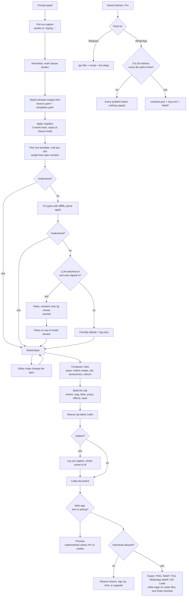

# How a sticker gets made

Every decision between a typed sentence and a downloaded file, in the order it happens, with the file that owns it
and the knob that changes it. Rules make every decision. A model is consulted only when the rules don't understand
a prompt, and only when that is switched on.

## Contents

1. [The pipeline at a glance](#the-pipeline-at-a-glance)
2. [Reading the prompt](#1-reading-the-prompt)
3. [Turning matches into a spec](#2-turning-matches-into-a-spec)
4. [When the rules don't understand](#3-when-the-rules-dont-understand)
5. [Composer rules](#4-composer-rules)
6. [Animation, still frame, caption and staging](#5-animation-still-frame-caption-and-staging)
7. [Web app gates](#6-web-app-gates)
8. [Export, packs and messenger limits](#7-export-packs-and-messenger-limits)
9. [A worked trace](#8-a-worked-trace)
10. [Where to tweak](#9-where-to-tweak)

## The pipeline at a glance

| Stage | File |
| --- | --- |
| Reading the prompt, voting | `studio/parse/parser.py`, `lexicon.yaml`, `templates.yaml` |
| Fallback | `studio/parse/fallback.py` |
| The spec and its allowed names | `studio/spec.py` |
| Composer rules and clip | `studio/compose.py`, `studio/motions.py`, `studio/colour.py` |
| Props, effects, things worn | `studio/extras.py`, `studio/accessories.py`, `mascot/props.py` |
| Mascots | `mascot/characters/biscuit.py`, `mochi.py`, `bruno.py` |
| Caption | `studio/caption.py` |
| Files | `studio/export.py` |
| Packs | `studio/packs.py` |
| Web app gates | `app/plans.py`, `app/render.py`, `app/main.py` |
| Beta: invites, waitlist, reports, counts | `app/main.py`, `app/admin.py` |

## 1. Reading the prompt

The prompt is read by rules only (`studio/parse/parser.py`). No model is called at this stage.

1. **Pull out the caption first.** Quoted text (`"Deal!"`, `'monday again'`) or whatever follows `saying`, `says`,
   `that says`, `with text`, `captioned`, `caption:` or `text:` becomes the caption, word for word. It is removed
   from the prompt so its words are never read as instructions. Bare `text` doesn't count, so "text me later" stays
   a request for a phone.
   - Tweak: the `QUOTED` and `SAYING` patterns at the top of `parser.py`.
2. **Normalise.** Lowercase, curly quotes to straight, every other character dropped except letters, digits and
   in-word apostrophes. Commas, full stops, `;`, `!` and `?` become a clause break `|`.
3. **Match phrases, longest first.** Every phrase in `lexicon.yaml` and `templates.yaml` is tried from the longest
   (in words) down to single words. A matched phrase claims its words, so a shorter phrase inside it can no longer
   match: "good night" never also counts as "good".
   - One phrase can belong to a template and a lexicon entry at the same time; both fire. Within the lexicon a
     phrase may belong to only one entry (the tests enforce this).
4. **Negation.** A match is negated when `not`, `no`, `never`, `don't`, `isn't`, `without` or a similar word appears
   up to 3 words before it. The look-back stops at a clause break or at a word another phrase already claimed, so
   "not happy, raining" negates only "happy".
   - A negated mood with a `not:` partner switches to that mood ("not happy" becomes `sad`). Any other negated word
     is dropped ("not waving" adds no wave).
5. **Unknown words.** Words no phrase claimed, minus stopwords, negators and clause breaks, are kept as `unknown`.
   They decide confidence in the next step and are logged when the rules give up.

What the parser can match:

| Source | Holds | Weight on conflicts |
| --- | --- | --- |
| `templates.yaml` | 33 whole scenarios (monday, birthday, thank you, on my way…), each a full spec plus a suggested caption | 1 (base layer) |
| `lexicon.yaml` moods | happy, sad, tired, angry, wink, love, shy… with face, tail, motion, sometimes effects | 2 |
| `lexicon.yaml` actions, props, effects, accessories | wave, jump, dance, phone, mug, confetti, party hat… | 3 |
| `lexicon.yaml` poses, colours, bases | sitting, hands on hips, purple, cat, bear… | 4 |
| `lexicon.yaml` intensity | very, super, so (×1.35); a bit, slightly (×0.65) | multiplies |

## 2. Turning matches into a spec

Every decision lands in one `StickerSpec` (`studio/spec.py`). The parser fills it, the editor chips change it, and
everything after this point reads only the spec.

1. **Pick at most one template.** Each matched template scores the number of words its phrases covered. The highest
   score wins; on a tie, the one mentioned first. "omg no way" scores `omg` 3 and `no_way` 2, so it becomes the OMG
   sticker. The template's values go in first, at weight 1.
2. **Vote on single-value slots.** `face`, `motion`, `stance`, `tail`, `arm_L`, `arm_R` and `base` each collect votes
   (weight, position, value). The highest weight wins; on a tie, the word that comes **later** in the prompt wins.
   "sleepy birthday" keeps the birthday props but takes the sleepy face (mood weight 2 beats template weight 1).
3. **Collect lists.** `props`, `effects` and `accessories` are unions in order of mention, capped at 2 props,
   3 effects and 3 accessories.
4. **Colours.** A colour word replaces the palette with that preset (`colours:` in the lexicon). The last one wins.
5. **Intensity.** Starts at 1.0, ×1.35 per strong word, ×0.65 per weak word, +8% per `!` (at most three count).
   Clamped to 0.5–1.6. Motions scale their amplitude by it.
6. **Caption.** The extracted caption wins. Otherwise, if a template matched and auto captions are on, the
   template's suggested caption is used.
7. **Confidence.** Understood when at least one template, mood, action, prop, pose or accessory matched, **and**
   unknown words are no more than half of the meaningful words (one unknown word is always tolerated). Not
   understood means the fallback runs (section 3).

Defaults when nothing sets a slot:

| Slot | Default |
| --- | --- |
| base | `biscuit` (fox) |
| face | `smiley` |
| motion | `idle` |
| stance | `stand` |
| tail, arms | chosen by the composer (section 4) |
| intensity | 1.0 |
| length | 2 seconds at 60 fps (120 frames) |

## 3. When the rules don't understand

The fallback (`studio/parse/fallback.py`) runs only when step 2 says "not understood". Each step ends the chain as
soon as the result is understood.

1. **Typo fix (free, no model).** Each unknown word of 3 or more letters is compared with every single word the
   lexicon knows (`difflib`, similarity cutoff 0.78). The closest match replaces it and the prompt is parsed again.
   "slepy fox wih cofee" becomes "sleepy fox with coffee".
2. **Small model (optional).** Only when the LLM switch is on (`--llm` on the command line; `STUDIO_LLM=1` in the web
   app, signed-in users only, `STUDIO_LLM_DAILY` calls a day each). Claude Haiku (`claude-haiku-5-5`, low effort)
   must answer a JSON schema whose fields are lists of the rig's own names: face, motion, stance, props, effects,
   accessories, plus `unknown_concepts` for what it can't show. It can't invent a pose or a prop.
   - The rules still win. The model's answer is a base layer: it sets face, motion or stance only where the rules
     matched nothing for that kind of slot, and its props, effects and accessories go after the rules' own.
   - Answers are cached by normalised prompt in `cache/llm.json`; the same wording never costs twice.
   - No credentials, an auth error, a network error, a refusal or a cut-off answer all mean "no answer".
3. **Log the miss.** Every prompt that reached this step is appended to `cache/misses.jsonl` with its unknown words
   and whether the model was used. Adding those words to `lexicon.yaml` is how the rules learn, and how model calls
   trend towards zero.
4. **Friendly default.** If nothing worked, the spec keeps its defaults (a smiling fox, idle). The editor says it
   wasn't sure and suggests other words.

## 4. Composer rules

The composer (`resolve()` in `studio/compose.py`) settles conflicts in a fixed order. Every change it makes is written
to `notes`, which the editor shows under the sticker.

1. **Props claim paws first.** Each prop has a preferred paw and a pose: phone right `hold`, clipboard left `hold`,
   bell right `ring`, badge and heart right `hold_up`, cloud right `carry`, mug right `hold`.
   - Preferred paw taken → the other paw, with a note ("phone moved to the left paw").
   - No paw free → the prop is dropped, with a note.
   - The gift needs both paws; with one busy it's dropped. When it fits, a standing mascot switches to the `wide`
     stance so its feet show either side of the box.
2. **The motion gets the paws that are left.** Wave and think want 1 paw; cheer, jump, dance, shiver and hide want 2;
   the rest want none.
   - Sitting (`sit` or `lotus`) and the motion needs legs (bounce, jump, cheer, dance, walk, shiver) → `sway`.
   - The motion needs a paw and none is free → `bounce`. With a gift, the gift becomes the act (step 7).
   - A wave whose right paw is busy waves with the left.
3. **Arm poses.** A claimed paw takes its prop's pose. A paw the motion uses is animated by the motion. Any other paw
   takes the pose the prompt asked for ("hands on hips"), else `knee` in the lotus stance, else `rest`.
4. **Accessories.** In order of mention. Each clash group allows one item: party hat or crown, glasses or sunglasses,
   bow or star clip. The later one is dropped, with a note.
5. **Tail follows the stance.** Sitting → only sitting poses (`ground`, `ground_up`, `wrap`): `up`, `out`, `flick_out`
   and `curl` become `ground_up`, anything else `ground` (`wrap` across the lap in lotus). Standing with a sitting
   pose → `ground` becomes `low`, `ground_up` becomes `up`, `wrap` becomes `rest`. Nothing asked → `rest`.
6. **Colours that show.** A recolour copies itself to every palette slot that shared that colour in the design (the
   cat's tail tip follows its stripes, the bear's follows its fur). Each coloured item (party hat, bow, scarf,
   headphones, heart, floating hearts, mug) then takes the first colour from its list that differs from the fur by
   at least 28 (CIE Lab distance, `studio/colour.py`). A pink cat's bow turns coral.
7. **Gift sequence.** With a gift and a loop of at least 100 frames: paws rest on the lid, the lid pops at frame 40,
   paws go to the cheeks, then up in a cheer at frame 78. The face goes curious, surprised, then joyful.

## 5. Animation, still frame, caption and staging

`build_clip()` in `studio/compose.py`, then the rig bakes it (`mascot/character.py`).

1. **Loop length.** `seconds × 60` frames (default 120). Every periodic movement uses a period that fits a whole
   number of times into the loop (`per()` in `studio/motions.py`), so the last frame equals the first and the loop
   has no seam.
2. **Size in the canvas.** 0.86 for jump, cheer or a cloud on a string (they need headroom); 1.06 when sitting;
   otherwise 1.0.
3. **Motion.** One of 14 functions in `studio/motions.py`, built from the rig's moves (`mascot/clips/moves.py`).
   Each returns its best still frame (jump apex, wave at the top of its swing…).
4. **Tail wag.** Strength from the `WAG` table per motion (2 for shiver to 12 for cheer and dance), halved when
   sitting, × intensity. Fast wag (30 frames) above 8, slow (60) otherwise.
5. **Blink.** One blink at 80% of the loop, except for sleep, calm, joy and wink faces and the hide and think motions.
6. **Props, effects, things worn.** Added as layers. Head items hang from the head's pivot and are placed from each
   mascot's crown, eye and ear positions, so they fit all three mascots and follow every head turn.
7. **Still frame (PNG, WebP).** The motion's best frame, moved later when a prop is still appearing: badge 34,
   phone 40, clipboard at half the loop, gift 90.
8. **Caption layout** (`studio/caption.py`). Text is drawn as vector outlines of Fredoka SemiBold, so every player
   shows it.
   - One line if it fits 460 px wide at 52 px or larger (tries 76 down to 52). Otherwise wrapped to at most two
     lines, shrinking from 76 down to 30 until it fits.
   - Bottom captions end at y = 500; top captions start at y = 14. Outline style = dark text with a white halo;
     bubble style = text on a yellow rounded panel.
9. **Staging.** With a caption, the whole scene is parented to one `stage` layer and shrunk to fit the rows the
   caption leaves free: scale = the smaller of 0.9 and free height ÷ 440. The feet land 6 px above a bottom caption,
   or at y = 496 under a top one.

## 6. Web app gates

`app/plans.py` decides; `app/render.py` applies it. Preview and download follow the same table.

| Who | Preview | Formats | Watermark | Limit |
| --- | --- | --- | --- | --- |
| Not signed in | yes | none (asked to create a free account) | yes | none on previews |
| Free account | yes | PNG, WebP | yes | `FREE_DAILY_EXPORTS` a day (5), reset at midnight UTC |
| Free account with credits | yes | all | no | each download uses 1 credit |
| Pro | yes | all, plus pack zips | no | none |

0. **Signing up.** With `STUDIO_INVITE_ONLY=1`, an account needs an invite code with uses left (codes are
   case-insensitive); otherwise anyone can sign up. Everyone can preview without an account either way.
1. **Which rule applies, in order:** unknown format → refused · not signed in → refused · Pro → allowed, clean ·
   credits left → allowed, clean, 1 credit used · format not PNG or WebP → refused with the upgrade reason · today's
   free downloads used up → refused with the reset time · otherwise allowed, watermarked, counted.
2. **Watermark.** "pawse studio" in small vector type in the bottom-right corner, or the top-right one when the
   caption sits at the bottom. It's drawn into the Lottie itself, so previews and every export format carry it.
3. **Cache.** Composed stickers are kept in memory by spec hash (256 most recent). Changing any chip makes a new hash.
   A new sticker usually composes in 0.1–0.7 s; confetti with a gift takes about 5 s. A repeat takes about 0.02 s.
4. **Other limits.** Prompts up to 200 characters, captions up to 60, 200 saved stickers, 30 in one pack zip. Login is
   slowed after 10 failures per email or 50 per network address in 15 minutes.
5. **Payments** (`app/billing.py`, Stripe Checkout). Pro is a monthly subscription; a credit pack is a one-time
   purchase of `PACK_CREDITS` (20) credits. Nothing is granted from the success page: only Stripe's signed webhook
   events change a plan or add credits, each event and each pack applied once.
   - Pro on: subscription created or updated with status `active` or `trialing`.
   - Pro off: subscription updated to any other status, or deleted.
   - Credits: checkout completed (or its delayed payment succeeded) in payment mode with status not `unpaid`.

## 7. Export, packs and messenger limits

`studio/export.py`. Rasterising uses rlottie; no browser is needed.

- **White edge.** PNG, WebP, WhatsApp WebP and GIF files get the sticker's silhouette grown by about 8 px in white
  under the image, as WhatsApp recommends. Telegram `.tgs` and Lottie files stay as drawn (Telegram shows them as they
  are).
- **Loop frames.** Animated files hold frames 0 to 119 of a 120-frame loop. Frame 120 is the same picture as frame 0,
  so it's left out; showing it would make the first pose appear twice at every loop.

| Format | What you get | Limit checked | When over |
| --- | --- | --- | --- |
| PNG | still frame, 512×512, transparent | none | — |
| WebP | still frame, 512×512, quality 90 | WhatsApp static ≤ 100 KB | warning |
| Telegram `.tgs` | gzipped Lottie, 512×512, 60 fps | ≤ 64 KB and ≤ 3 s | warning |
| WhatsApp animated WebP | 512×512 loop | ≤ 500 KB | steps down 30 → 20 → 15 fps and quality 75 → 45 until it fits, then warns |
| GIF | 20 fps loop | none | — |
| Lottie JSON | the full animation | none | — |

**Packs** (`studio/packs.py`, Pro, up to 30 saved stickers, oldest first):

| Pack | In the zip | Checked before zipping | When a check fails |
| --- | --- | --- | --- |
| Telegram | numbered `.tgs` files, `HOW-TO-ADD-TO-TELEGRAM.txt` with steps for @Stickers and one emoji per file | 512×512, 30 or 60 fps, ≤ 3 s, ≤ 64 KB each | refused, every problem listed |
| WhatsApp | `contents.json` (WhatsApp sample-app format), `tray.png` (96×96, ≤ 50 KB), numbered `.webp`, `HOW-TO-ADD-TO-WHATSAPP.txt` | 3–30 stickers; all animated or all still; ≤ 500 KB animated or ≤ 100 KB still; frames ≥ 8 ms; ≤ 10 s; 1–3 emoji | refused, every problem listed |

- **Emoji per sticker:** what it does (wave 👋, dance 💃, doze 😴…), then what it holds (mug ☕, gift 🎁…), then
  what's around it (confetti 🎉, anger 💢…), then its face. No repeats; Telegram gets the first, WhatsApp up to three.
- **Accessibility text** for WhatsApp is written from the spec: "An angry cat shaking its head, with the words "no.""
- **Animated WhatsApp stickers use frame 0** as the still WhatsApp shows when a loop ends, so frame 0 must show the
  whole sticker; every motion starts from a complete pose.

## 8. A worked trace

Prompt: `super sleepy purple kitty with coffee and a scarf saying 'monday again'`

| Stage | Decision |
| --- | --- |
| Caption | `monday again` taken from the quotes and removed from the prompt |
| Matches | `super` → strong · `sleepy` → mood tired · `purple` → colour · `kitty` → base mochi · `coffee` → prop mug · `scarf` → accessory |
| Template | none matched |
| Votes | face `sleep`, stance `sit`, motion `sleep` (all from the tired mood, weight 2); base `mochi` (weight 4) |
| Intensity | 1.0 × 1.35 = 1.35 |
| Understood? | yes, nothing unknown; no fallback |
| Paws | mug claims the right paw (`hold`); left paw `rest` |
| Motion | `sleep` works sitting; kept |
| Tail | sitting, nothing asked → `ground` |
| Colours | purple preset; cat's tail tip follows the new stripe colour; scarf stays coral and mug teal (both stand out from purple) |
| Size | 1.06 (sitting) |
| Still frame | 0 |
| Caption | fits one line at 72 px; scene shrunk to 0.9 and lifted 61 px |
| Files | TGS 8.0 KB, PNG 53 KB, WhatsApp WebP 452 KB; made in 2.0 s |

## 9. Where to tweak

| To change | Edit | Effect |
| --- | --- | --- |
| What a word means | `studio/parse/lexicon.yaml` | the word's slots; one entry per phrase |
| A whole scenario | `studio/parse/templates.yaml` | base spec and suggested caption |
| Who wins a conflict | `WEIGHT` in `parser.py` | template 1, moods 2, actions/props/effects/accessories 3, poses/colours/bases 4 |
| How many props, effects, worn items | `MAX_PROPS`, `MAX_EFFECTS`, `MAX_WEAR` in `parser.py` | 2, 3, 3 |
| How strong "very" or "a bit" is | the `1.35` / `0.65` factors and the `!` bonus in `parser.py` | intensity |
| When the parser gives up | the `confident` line in `parser.py` | how often the fallback runs |
| Typo tolerance | `cutoff=0.78` in `fallback.py` | lower fixes more, risks wrong guesses |
| The fallback model | `MODEL`, `SYSTEM` in `fallback.py`; `STUDIO_LLM`, `STUDIO_LLM_DAILY` | which model, its brief, on/off, daily cap |
| Which paw a prop uses, its pose | `PROPS` in `compose.py` | paw claims and notes |
| When a prop is visible in the still | `SHOW_AT` in `compose.py` | still frame |
| Motions, and which need paws or legs | `MOTIONS` and `WAG` in `motions.py` | swaps and tail wag |
| Things that can't be worn together | `EXCLUSIVE` in `accessories.py` | dropped items |
| Colour clash threshold, colour order | `MIN_DELTA`, `PREFS` in `colour.py` | which colour an item takes |
| Caption size and wrapping | `layout()` in `caption.py` | font size, lines |
| Room left for the mascot under a caption | `FIGURE` in `compose.py` | scene scale |
| Loop length | `seconds` in the spec (1–3) | frames, file size |
| Free downloads a day, credits per pack | `FREE_DAILY_EXPORTS`, `PACK_CREDITS` | plan limits |
| Which formats are free | `FREE_FORMATS` in `app/plans.py` | gates |
| Watermark words | `MARK` in `app/render.py` | preview and free downloads |
| Messenger size limits | `TGS_MAX`, `WA_ANIM_MAX`, `WA_STILL_MAX` in `export.py` | warnings and frame-rate steps |
| White edge width | `r=8` in `die_cut()` in `export.py`; `outline=` in `save()` | sticker border on raster files |
| Emoji chosen for packs | `MOTION_EMOJI`, `PROP_EMOJI`, `EFFECT_EMOJI`, `FACE_EMOJI` in `packs.py` | pack emoji |
| Pack size and rules | `WA_MIN`, `WA_MAX`, `TRAY_MAX`, `TG_MAX_SECONDS` in `packs.py`; `PACK_MAX` in `app/main.py` | what a pack may hold |
| Invite-only signup | `STUDIO_INVITE_ONLY`; codes from `python -m app.admin invite` | who can create an account |
